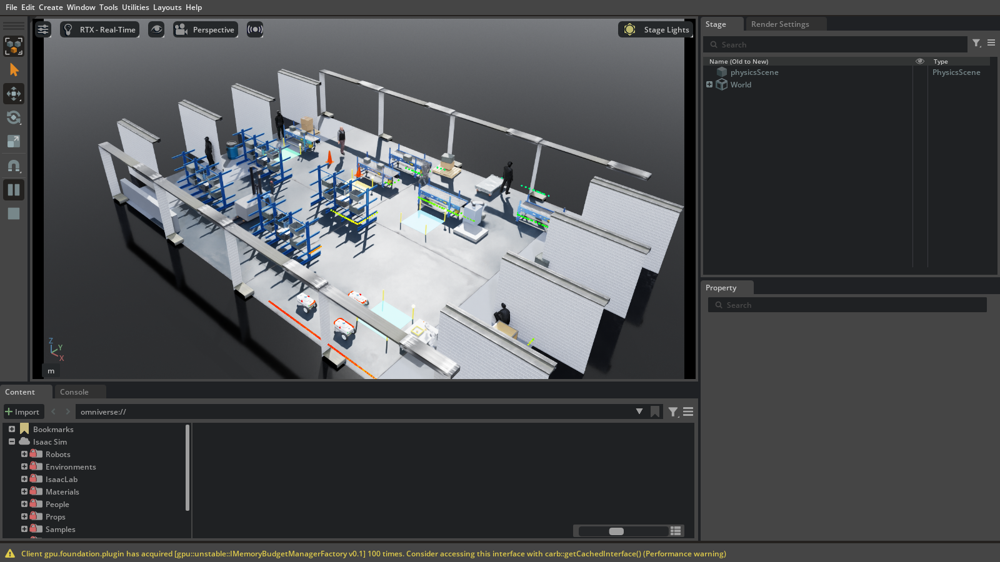
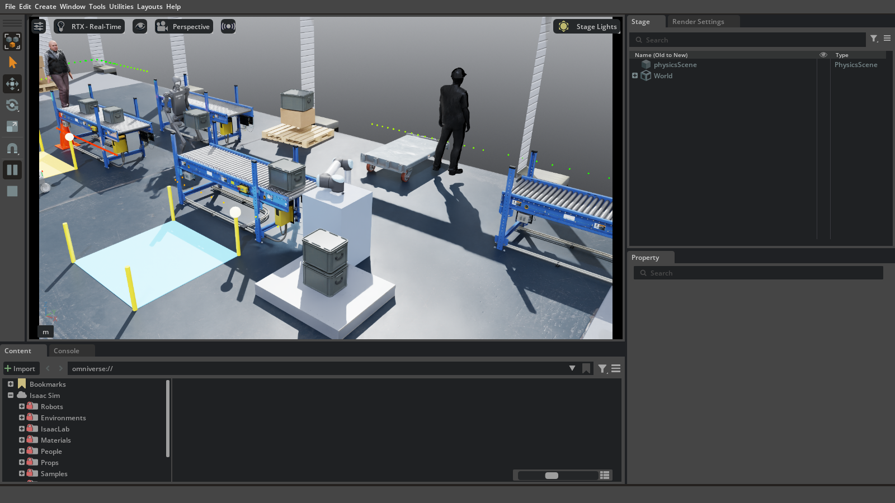

# Warehouse Robotics — Isaac Sim 5.1 + ROS 2 Humble

A reproducible industrial warehouse simulation for **NVIDIA Isaac Sim 5.1** and
**ROS 2 Humble**. The scene combines a working AMR fleet, a UR10 conveyor
palletising cell, a Unitree H1 material-handling task, a Franka pick-and-place
cell, a kinematic forklift, and NVIDIA SimReady warehouse set dressing.

The simulation owns physics, sensors, robot articulation, and the visual
process. ROS 2 owns fleet allocation, planning, traffic control, and robot
commands. Both sides read the same `config/warehouse.yaml`, so the visible
scene and the planner geometry cannot silently disagree.

A browser operations dashboard connects directly to the ROS 2 graph for live
mapping, fleet/process telemetry, work-order dispatch, autonomous/paused/
emergency-stop control, and per-robot teleoperation.





---

## Contents

- [What the demo shows](#what-the-demo-shows)
- [Requirements](#requirements)
- [Setup from scratch](#setup-from-scratch)
- [Running the demo](#running-the-demo)
- [What to watch](#what-to-watch)
- [Architecture](#architecture)
- [Project layout](#project-layout)
- [Configuration](#configuration)
- [ROS 2 interface](#ros-2-interface)
- [Operating the demo](#operating-the-demo)
- [Verification and expected results](#verification-and-expected-results)
- [Troubleshooting](#troubleshooting)
- [Design notes and limitations](#design-notes-and-limitations)
- [Third-party assets](#third-party-assets)

---

## What the demo shows

| System | Role | Visible behaviour |
|---|---|---|
| **3 × Nova Carter AMRs** | Warehouse transport | A* routes, LiDAR safety, station reservations, task handover, parking |
| **1 × Franka Panda** | Fixed-cell pick-and-place | Picks two cubes, places them on a tray, resets the cell |
| **1 × UR10** | Conveyor palletising | Picks a tote from the staging belt roller surface, stacks it on an output pallet |
| **1 × Unitree H1** | Humanoid material handling | Carries totes from a receiving conveyor to a packing conveyor |
| **1 × forklift** | Dynamic obstacle | Kinematic route through the rack cross-aisle; yields to AMRs |
| **NVIDIA SimReady props** | Set dressing | Racks, stock, totes, pallets, conveyors, safety equipment, and visual props |
| **NVIDIA People crew** | Human motion | Animated workers follow A*-planned routes, with idle and look-around behaviours |
| **Operations dashboard** | ROS 2 web client | Live occupancy map, fleet and process state, task dispatch, E-stop, and teleop |

The current build deliberately keeps the process **visible and deterministic**:

- Conveyor loads sit on the A08 roller surface, not in mid-air.
- The UR10’s pick tote sits on the staging conveyor and is visibly carried,
  stacked, and reset on the output pallet.
- The H1’s handoff totes sit on the two humanoid conveyor surfaces.
- AMRs show a carried tote only while travelling.
- The forklift and AMR planner share a keep-out aisle, so the forklift cannot
  drive into a moving robot.
- The NVIDIA People workers move through the baked NavMesh; the AMR planner
  treats them as dynamic obstacles.

The scene is 20 m × 14 m. The fleet runs a managed tote flow with six work-order
templates, live inventory accounting, and supplier/shipping replenishment. The
dashboard is the operator view of that flow.

---

## Requirements

### Tested environment

This repository was developed and exercised on:

| Component | Tested value |
|---|---|
| OS | Ubuntu 22.04 |
| ROS 2 | Humble Hawksbill |
| Isaac Sim | 5.1.0 standalone (`python.sh`) |
| GPU | NVIDIA RTX 4050 Laptop GPU, 6 GB VRAM |
| Python for ROS nodes | 3.10 (Humble) |
| Python inside Isaac Sim | Isaac Sim’s bundled interpreter |
| Renderer | Raytraced Lighting (`RTX - Real-Time` viewport) |
| ROS middleware | `rmw_fastrtps_cpp` |

### Software

1. **NVIDIA Isaac Sim 5.1 standalone.** Download it from NVIDIA and make sure
   the launcher exists:

   ```bash
   test -x /path/to/isaac-sim-standalone-5.1.0-linux-x86_64/python.sh
   ```

   The scripts default to:

   ```text
   /home/arun/Downloads/isaac-sim-standalone-5.1.0-linux-x86_64
   ```

   Set `ISAAC_SIM_ROOT` to override that path.

2. **ROS 2 Humble**, installed and sourceable from
   `/opt/ros/humble/setup.bash`. Follow the official ROS 2 Humble installation
   instructions for your Ubuntu release.

3. **ROS build/runtime tools** available on the machine:

   ```bash
   source /opt/ros/humble/setup.bash
   sudo apt update
   sudo apt install -y \
     python3-colcon-common-extensions \
     python3-yaml \
     ros-humble-rviz2
   ```

   `rviz2` is optional for the demo but is used by the supplied RViz layout.

4. **A recent NVIDIA driver** with a working RTX GPU. Headless mode still needs
   a GPU. The visual NVIDIA asset layer is considerably heavier than headless
   mode.

### Network and assets

- The warehouse demo does **not** vendor large NVIDIA USD assets. Isaac Sim
  resolves the assets from its configured asset root and may download them on
  first use. An internet connection is required the first time visual mode
  loads the set dressing.
- The NVIDIA assets used here are part of Isaac Sim 5.1’s
  `Assets/Isaac/5.1` content. They are not redistributed by this repository.
- Headless mode skips the NVIDIA set-dressing layer by default, so a headless
  smoke test can run without the visual asset download.
- Use `--no-nvidia-assets` in visual mode to run with procedural fallback
  geometry if assets are unavailable.

### Optional LeKiwi packages

`ros2_ws/src/` also contains the older `lekiwi_isaac_hardware` and
`lekIwi_ros2_control` packages. They are unrelated to the warehouse demo and
are not required to run it. The demo build command selects only
`warehouse_fleet`. To build the LeKiwi packages as well, install the ROS 2
control dependencies declared in their `package.xml` files
(`ros2_control`, `controller_manager`, controllers, `xacro`, etc.) and build
the full workspace.

---

## Setup from scratch

### 1. Clone the repository

```bash
git clone https://github.com/dreamerarun/warehouse-robotics-isaac.git
cd warehouse-robotics-isaac
```

If you downloaded the repository as an archive, `cd` into the extracted
`warehouse_robotics_isaac` directory instead.

### 2. Point the scripts at Isaac Sim

```bash
export ISAAC_SIM_ROOT="$HOME/Downloads/isaac-sim-standalone-5.1.0-linux-x86_64"
test -x "$ISAAC_SIM_ROOT/python.sh" && echo "Isaac Sim launcher OK"
```

Add the export to `~/.bashrc` if you do not want to repeat it in every shell.

### 3. Build the ROS 2 workspace

```bash
source /opt/ros/humble/setup.bash
cd ros2_ws
colcon build --symlink-install --packages-select warehouse_fleet
source install/setup.bash
cd ..
```

The `--symlink-install` flag matters: `config/warehouse.yaml` is symlinked into
the installed package share so the simulator and ROS nodes always use the same
configuration file.

Check that the package is visible:

```bash
ros2 pkg prefix warehouse_fleet
ros2 pkg executables warehouse_fleet
```

Expected executables include `fleet_manager`, `amr_agent`, `franka_arm`,
`humanoid_patrol`, `fleet_monitor`, `dashboard_server`, `submit_task`, and
`teleop_amr`.

### 4. Set the ROS environment

For every autonomy shell:

```bash
source /opt/ros/humble/setup.bash
source ros2_ws/install/setup.bash
export WAREHOUSE_CONFIG="$PWD/config/warehouse.yaml"
export ROS_DOMAIN_ID=0
export RMW_IMPLEMENTATION=rmw_fastrtps_cpp
```

`run_demo.sh` does this automatically. `run_autonomy.sh` also sets these
defaults. Use the same `ROS_DOMAIN_ID` and `RMW_IMPLEMENTATION` for the
simulator and any separately launched autonomy process.

### 5. Smoke test the simulation alone

```bash
scripts/run_sim.sh --headless --duration 20
```

This builds the world, loads the robots, and exits after 20 simulated seconds.
It does not start the fleet manager. Look for the scene startup messages and no
fatal asset errors.

To smoke test the animated People crew and the baked NavMesh separately:

```bash
scripts/run_sim.sh --headless --nvidia-assets --people --no-ros --duration 20
```

The `--nvidia-assets` flag is required in headless mode because the People
crew resolves its character assets and obstacle geometry from the NVIDIA asset
layer. The HUD/status should eventually show `people=5 agents navmesh=ok`.
If the NavMesh bake fails, the worker command loop cannot plan routes and the
agents stay parked.

Then test the full stack:

```bash
scripts/run_demo.sh --headless --duration 60
```

The demo script builds `warehouse_fleet` on first use if needed, starts Isaac
Sim, waits for `/amr1/odom`, and then launches the ROS 2 autonomy stack.

---

## Running the demo

### Headless — recommended for repeatable tests

```bash
cd /home/arun/warehouse_robotics_isaac
scripts/run_demo.sh --headless --duration 120
```

The first start can take 30–90 seconds while Isaac Sim initialises. Headless
mode uses procedural/collision geometry by default for speed and predictability.

### Visual mode

```bash
scripts/run_demo.sh
```

The viewport shows the complete warehouse process. The demo starts with the
`overview` camera. Use the mouse to orbit, pan, and zoom as usual.

The animated NVIDIA People crew is part of the default visual run. Workers
follow the routes from `config/warehouse.yaml` through the Isaac Sim People
command layer and the baked navigation mesh.

### Operations dashboard

The launch stack starts a ROS 2 dashboard node and a small standard-library
HTTP server. Open:

```text
http://127.0.0.1:8080
```

The dashboard shows:

- the live `fleet/map` occupancy grid, scene geometry, AMR poses and planned
  paths;
- connected AMRs, H1, Franka, UR10, and forklift status;
- managed work orders, inventory, pallet stack, and conveyor state;
- `Autonomous`, `Pause`, and `E-STOP` fleet modes;
- per-robot teleoperation with a keyboard/D-pad dead-man channel;
- UR10 pause/resume/pallet-reset controls and a live event stream.

To expose the dashboard on another interface (only on a trusted network):

```bash
scripts/run_demo.sh --dashboard-host 0.0.0.0 --dashboard-port 8080
```

Use `--no-dashboard` to start the simulation and autonomy without the web
server. If the port is already in use, pass `--dashboard-port 8081` or set
`dashboard.port` in the YAML.

### Camera presets

```bash
scripts/run_demo.sh --camera overview --no-hud
scripts/run_demo.sh --camera ur10 --no-hud
scripts/run_demo.sh --camera h1 --no-hud
```

| Preset | View |
|---|---|
| `overview` | High south-east isometric of the whole hall |
| `ur10` | Close-up of the staging conveyor and output stack |
| `h1` | Close-up of the humanoid conveyor handoff |

Reference captures are in `screenshots/`. The HUD reports AMR poses, Franka and
UR10 state, H1 position, forklift position, People agent poses, simulation
time, and the number of ROS graphs.

### Simulation only and autonomy only

Use two terminals to inspect each half independently:

```bash
# Terminal 1 — Isaac Sim
scripts/run_sim.sh

# Terminal 2 — ROS 2 autonomy
scripts/run_autonomy.sh rviz:=true
```

The simulator can be started with its own arguments by calling
`scripts/warehouse_sim.py` through Isaac Sim’s `python.sh`:

```bash
"$ISAAC_SIM_ROOT/python.sh" scripts/warehouse_sim.py --headless --no-ros --duration 10
```

### Useful variants

```bash
scripts/run_demo.sh --headless --duration 120 --no-humanoid
scripts/run_demo.sh --headless --duration 120 --no-franka
scripts/run_demo.sh --headless --duration 120 --no-industrial
scripts/run_demo.sh --headless --domain-id 7
scripts/run_demo.sh --camera ur10 --nvidia-assets --no-hud
scripts/run_autonomy.sh robots:=amr1,amr2 franka:=false
scripts/run_demo.sh -- rviz:=true monitor:=false
scripts/run_demo.sh --headless --nvidia-assets --people --duration 60
scripts/run_demo.sh --no-people --duration 60
```

### `run_demo.sh` options

| Option | Meaning |
|---|---|
| `--headless` | No viewport; NVIDIA set dressing is off by default |
| `--duration SECONDS` | Stop after N simulated seconds; useful for CI |
| `--camera {overview,ur10,h1}` | Start the viewport at a named preset |
| `--no-hud` | Hide the viewport status overlay |
| `--people` | Enable the NVIDIA People dynamic crew and baked NavMesh |
| `--no-people` | Disable the NVIDIA People dynamic crew and baked NavMesh |
| `--no-franka` | Do not create or control the Franka cell |
| `--no-humanoid` | Do not create or control the H1 |
| `--no-industrial` | Skip the UR10 palletising cell |
| `--nvidia-assets` | Force the NVIDIA visual layer on |
| `--no-nvidia-assets` | Force procedural visuals in visual mode |
| `--no-autonomy` | Start Isaac Sim only |
| `--no-dashboard` | Do not start the browser dashboard node |
| `--dashboard-host HOST` | Dashboard bind address (default `127.0.0.1`) |
| `--dashboard-port PORT` | Dashboard HTTP port (default `8080`) |
| `--build` | Rebuild `warehouse_fleet` before starting |
| `--domain-id N` | Set `ROS_DOMAIN_ID` for the simulator and autonomy |
| `-- ARGS...` | Pass remaining arguments to `ros2 launch` |

`run_sim.sh` passes all arguments directly to `scripts/warehouse_sim.py`.
`run_autonomy.sh` passes all arguments to
`ros2 launch warehouse_fleet fleet.launch.py`.

### Launch arguments

| Argument | Default | Purpose |
|---|---|---|
| `config:=PATH` | installed `warehouse.yaml` | Configuration file |
| `robots:=amr1,amr2` | all configured AMRs | Start agents for a subset |
| `franka:=true|false` | `true` | Start Franka controller |
| `franka_loop:=true|false` | `true` | Repeat the Franka sequence |
| `humanoid:=true|false` | `true` | Start H1 controller |
| `monitor:=true|false` | `true` | Print the fleet dashboard |
| `markers:=true|false` | `true` | Publish RViz markers |
| `dashboard:=true|false` | `true` | Start the browser operations dashboard |
| `dashboard_host:=HOST` | config | Dashboard bind address |
| `dashboard_port:=PORT` | config | Dashboard HTTP port |
| `rviz:=true|false` | `false` | Start RViz |
| `domain_id:=N` | inherit shell | Set `ROS_DOMAIN_ID` for launched nodes |

---

## What to watch

### Managed AMR task flow

The default `tasks.managed: true` mode turns the template list into a live
warehouse flow. Each template declares the tote stock it consumes and produces:

| Template | Pickup | Drop-off | Consumes | Produces |
|---|---|---|---|---|
| T1 | `inbound` | `staging` | inbound | staging |
| T2 | `staging` | `outbound` | staging | outbound |
| T3 | `inbound` | `outbound` | inbound | outbound |
| T4 | `outbound` | `staging` | empty | staging |
| T5 | `staging` | `arm_dock` | staging | arm_dock |
| T6 | `arm_dock` | `inbound` | arm_dock | inbound |

The fleet manager only dispatches a work order when its source stock is
available and the destination has capacity. Stock is reserved when an AMR is
assigned, then committed when the drop-off dwell completes. The receiving
conveyor replenishes `inbound`; the shipping conveyor consumes `outbound` and
returns `empty` totes. This prevents the queue from manufacturing or losing
totes. A manually submitted task is always accepted and is not part of the
managed inventory accounting.

AMR roles and preferred templates are configured per robot:

- `amr1` prefers receiving/cross-dock work (`T1`, `T3`);
- `amr2` prefers staging/palletising and QA (`T2`, `T5`);
- `amr3` prefers empty-tote and inspection returns (`T4`, `T6`).

The fleet manager chooses an idle AMR by template preference, distance, and
priority. After a pickup the robot displays a carried tote while in transit. At
a station pad it dwells, then either takes the next hot task at the drop-off or
drives to its dedicated parking spot when the queue is empty.

By default `fleet.max_active_amrs: 1`. The station aisle is narrow, so one AMR
executes tasks at a time. The other two Carters remain visible in their parked
positions. This is intentional and prevents three robots from meeting head-on
in an aisle that is only about 2 m wide. The inactive robots can still be
controlled or manually tested, but the autonomy stack will not allocate a new
task to them until an active slot is free.

The UR10 cell consumes totes from the physical staging infeed and publishes
its own stack/shipping counters on `/ur10/status`. The dashboard shows both the
fleet work-order inventory and the live UR10 infeed stock so the conveyor-to-
pallet path is visible.

When `tasks.managed` is false, the older fixed-cycle queue is used; it repeats
when `tasks.loop: true`.

### Conveyors and the UR10 cell

The five conveyors use NVIDIA `ConveyorBelt_A08` straight roller-bed meshes.
The fitted roller surface is at **z = 0.769 m**. This number is shared by:

- conveyor totes,
- the H1 handoff totes,
- the UR10 pick tote,
- and the visual payload placement in `warehouse_process.py`.

The staging conveyor is reserved for the UR10 pick tote; there is no second
animated tote travelling through the arm’s pick point. The inbound and outbound
conveyors have moving render-only totes. The two humanoid conveyors have their
own pickup and delivery loads.

The UR10 uses an Isaac RMPflow pick-place controller with a render-only visual
suction grasp:

1. Descend to the pick tote lid on the staging belt.
2. Attach the tote with a fixed end-effector offset.
3. Carry it to the output pallet.
4. Snap the finished tote onto the stack.
5. Reset the pick tote after the configured dwell and repeat.

The default stack is **3 totes**, with stack step **0.30 m**. The output pallet
is at `(4.60, 2.30)` with its top at `0.15 m`. Stack centres are approximately
`z = 0.29`, `0.59`, and `0.89 m`.

The arm is not driven by a ROS action server. Isaac Sim runs the pick-place
state machine locally, consumes physical staging stock when an AMR unloads a
tote, and publishes stack/shipping/status JSON on `/ur10/status` and
`/warehouse/process_status`. With no ROS fleet (`--no-ros` or a bare simulation
smoke test) it falls back to a timed visual feed so the cell still runs.

The dashboard can pause/resume the cell or clear a full output pallet; those
commands are edge-triggered pulses on `/ur10/command`. The cell does not model
a physics contact grasp.

### H1 material handling

The H1 starts in the handoff lane and follows a material-handling task:

- Pickup at the receiving conveyor: `(-1.0, 3.95)`.
- Drop-off at the packing conveyor: `(6.8, 3.95)`.
- Load/unload dwell: 3 seconds each.
- Totes are shown in the H1’s arms and left on the conveyor surface.

The humanoid uses Isaac Sim’s flat-terrain walking policy. If it falls, the
simulator teleports it back to its spawn and the patrol node restarts the
route. It does not plan around AMRs; AMRs treat it as a dynamic obstacle.

### Franka cell

The Franka Panda picks cube A, places it on the tray, picks cube B, places it,
then resets both cubes after a short delay. The waypoints are pre-solved Lula
IK joint targets streamed from ROS as `sensor_msgs/JointState`. This is a
deliberately simplified, repeatable grasp model rather than a contact-rich
gripper simulation.

### Forklift

The forklift is kinematic and follows a deterministic route along the rack
cross-aisle at `x = -3.8`. It holds whenever an AMR is inside its conservative
swept corridor or beside the mast. The fleet planner treats the forklift aisle
as a no-go region for AMRs, so AMRs route through the north/south corridors
instead of competing with it head-on.

### People crew

The demo ships five animated workers from NVIDIA’s character content. They do
not use custom procedural walking; their motion comes from the Isaac Sim People
behaviour, the `Biped_Setup` animation graph, and the navigation stack.

Worker behaviour is driven by YAML routes:

```yaml
people:
  enabled: true
  number_of_loop: inf
```

The `people.workers` list supplies the worker names, character assets, spawn
poses, movement routes, and idle/look-around actions. The exact coordinates and
dwell times live in `config/warehouse.yaml`.

The runtime generates the `GoTo` / `Idle` / `LookAround` command file, and the
NavMesh drives the planned paths.

You can watch the crew in the visual viewport or through the simulator status.
The status line reports `people=<n> agents navmesh=<ok|FAIL>` plus each worker’s
position. If the NavMesh reports `FAIL`, worker commands are not accepted and
the crew remains parked.

---

## Architecture

```text
┌──────────────────────────────────────────────────────────────┐
│ Isaac Sim 5.1 — Python 3.11, bundled ROS 2 bridge           │
│                                                              │
│  warehouse_sim.py        app, physics, render loop           │
│  warehouse_scene.py      floor, walls, racks, materials      │
│  warehouse_robots.py     Carter, Franka, Forklift, H1        │
│  warehouse_nvidia.py     SimReady asset fitting              │
│  warehouse_people.py     People crew + baked NavMesh        │
│  warehouse_process.py    conveyors, UR10, payload visuals    │
│  warehouse_ros2.py       OmniGraph action graphs             │
│                                                              │
│  200 Hz physics / 30 Hz rendering / PhysX 2-D LiDAR          │
└──────────────────────────┬───────────────────────────────────┘
                           │ OmniGraph ROS 2 bridge
                           │ cmd_vel, odom, scan, TF,
                           │ joint states, forklift odom
┌──────────────────────────┴───────────────────────────────────┐
│ ROS 2 Humble — Python 3.10                                   │
│                                                              │
│  fleet_manager      queue, A*, traffic, pads, parking        │
│  amr_agent ×3       pure pursuit, scan safety, recovery      │
│  franka_arm         joint waypoints and gripper commands     │
│  humanoid_patrol    H1 velocity route and recovery           │
│  fleet_monitor      console status                           │
│  dashboard_server   HTTP API + browser operations dashboard  │
│  RViz               paths, markers, scans (optional)         │
└──────────────────────────────────────────────────────────────┘
```

The simulation never imports host `rclpy`; it uses Isaac Sim’s bundled bridge.
The ROS nodes never import `isaacsim`. This separation is what makes the
headless and visual modes interchangeable.

### Why the visual/collision split?

The planner and PhysX must agree about geometry. The simple rectangles in
`config/warehouse.yaml` are therefore the authoritative collision geometry.
NVIDIA racks, stock, and props are added only as visuals with their colliders
and rigid bodies disabled. This avoids a class of bugs where a beautiful mesh
blocks a robot that the planner thinks is free, or a LiDAR sees a prop that the
occupancy map does not contain.

The process visuals (conveyor totes, UR10 tote, H1 payload, AMR payload) are
also render-only. Their placement is calculated from the same configuration
values that position the physical stations and belts.

---

## Project layout

```text
warehouse_robotics_isaac/
├── README.md
├── .gitignore
├── config/
│   └── warehouse.yaml              # scene + fleet single source of truth
├── assets/
│   ├── README.md
│   ├── warehouse_start.usda       # minimal template stage opened by People
│   └── lekiwi/                     # optional older LeKiwi assets
├── screenshots/
│   ├── warehouse_overview.png
│   └── ur10_palletising.png
├── scripts/
│   ├── warehouse_sim.py            # Isaac Sim app and main loop
│   ├── warehouse_scene.py          # floor, walls, racks, lights, materials
│   ├── warehouse_robots.py         # AMR, Franka, Forklift, H1 adapters
│   ├── warehouse_nvidia.py         # NVIDIA SimReady assets and fitting
│   ├── warehouse_people.py         # People crew + NavMesh integration
│   ├── warehouse_process.py        # conveyors, UR10, H1/AMR payload visuals
│   ├── warehouse_ros2.py           # OmniGraph ROS 2 bridge
│   ├── warehouse_ros_env.py        # bridge environment setup
│   ├── run_demo.sh                 # simulator + autonomy, one command
│   ├── run_sim.sh                  # simulator only
│   ├── run_autonomy.sh             # autonomy only
│   ├── check_topics.sh             # topic/rate sanity check
│   └── test_*.py                   # earlier prototypes, kept for reference
├── ros2_ws/
│   └── src/
│       ├── warehouse_fleet/        # active warehouse autonomy package
│       │   ├── warehouse_fleet/
│       │   │   ├── dashboard_server.py   # HTTP API + ROS 2 bridge
│       │   │   └── web/                  # dashboard HTML/CSS/JS
│       │   └── ...
│       └── lekIwi_*                # optional, unrelated LeKiwi packages
└── ros2_ws/{build,install,log}/    # generated, not committed
```

The `scripts/test_*.py` files and `scripts/launch_warehouse.py` are earlier
prototypes and are not used by the current demo. They are included so the
history of the project remains inspectable.

---

## Configuration

`config/warehouse.yaml` is the single source of truth for both sides. At build
time it is symlinked into the installed ROS package share.

| Section | Controls |
|---|---|
| `world` | Bounds, physics rate, render rate, default ROS domain |
| `scene.pallets` | Decorative and output pallets |
| `scene.racks` | Rack rows and aisle geometry |
| `scene.conveyors` | Conveyor positions, sizes, and belt obstacles |
| `scene.forklift` | Kinematic forklift route, speed, safety radius, planner no-go |
| `scene.industrial` | UR10 base, pick, place, tote size, stack behaviour |
| `scene.static_obstacles` | Franka table, charging bank, conveyors, UR10 pedestal |
| `scene.stations` | Pickup, drop-off, and dock pads |
| `scene.parking` | Dedicated AMR parking spots |
| `amrs` | AMR spawn, speed, right-of-way, LiDAR mount |
| `franka` | Base pose, cubes, tray, joint waypoints, sequence |
| `humanoid` | Spawn, material-handling pickup/drop-off, speed |
| `people` | Animated crew, routes, command file, agent settings, NavMesh |
| `tasks` | Managed/fixed queue, inventory, capacities, supplier/shipping periods |
| `fleet` | Grid resolution, inflation, dwell, traffic, task slots, teleop limits |
| `dashboard` | Browser bind address, port, state period, event history |

If you move a station, conveyor, pallet, rack, or robot spawn, update the YAML
and rebuild/relaunch. Do not move only the visible NVIDIA mesh: the planner and
collision model read the YAML rectangles, not the mesh transforms.

### Important coordinate conventions

- Metres, `+X` east, `+Y` north, `+Z` up.
- Yaw is counter-clockwise about `+Z`.
- Physics: **200 Hz** (`world.physics_dt = 0.005`).
- Rendering: **30 Hz** (`world.rendering_dt = 0.0333333`).
- The H1 walking policy requires the 200 Hz physics rate.
- Conveyor roller surface: **0.769 m**.
- UR10 output pallet top: **0.15 m**.

### People crew and navigation

The animated workforce is implemented with NVIDIA’s own motion stack:

- `scripts/warehouse_people.py` enables the `omni.anim.*` extensions.
- It opens `assets/warehouse_start.usda` through the Isaac Sim USD context.
- It authors the shared `Biped_Setup` animation graph and attaches each worker
  under `/World/People/WorkerN` as a dynamic character.
- It bakes a NavMesh from the visible scene geometry and starts the Isaac Sim
  People command loop.

`config/warehouse.yaml` is the source of truth for the crew. It defines worker
assets, spawn poses, routes, idle/look-around actions, agent radius, NavMesh
settings, and the behaviour-loop duration.

The generated People command file is written at runtime from the YAML worker
routes and is passed to the Isaac Sim People behaviour. The command format is:

```text
WorkerN GoTo x y 0 yaw
WorkerN Idle seconds
WorkerN LookAround seconds
```

The default loop uses `inf` for repeated execution.

---

## ROS 2 interface

### AMR topics

`<ns>` is `amr1`, `amr2`, or `amr3`.

| Topic | Type | Direction |
|---|---|---|
| `/<ns>/cmd_vel` | `geometry_msgs/Twist` | autonomy → simulation |
| `/<ns>/odom` | `nav_msgs/Odometry` | simulation → autonomy |
| `/<ns>/scan` | `sensor_msgs/LaserScan` | simulation → autonomy |
| `/<ns>/path` | `nav_msgs/Path` | fleet manager → agent |
| `/<ns>/hold` | `std_msgs/Bool` | fleet manager → agent |
| `/<ns>/speed_scale` | `std_msgs/Float32` | fleet manager → agent |
| `/<ns>/mode` | `std_msgs/String` | fleet manager → agent (`AUTO`, `TELEOP`, `STOPPED`) |
| `/<ns>/teleop_cmd_vel` | `geometry_msgs/Twist` | dashboard/teleop → agent |
| `/<ns>/load_state` | `geometry_msgs/Twist` | fleet manager → simulation (`linear.x` 0/1) |
| `/<ns>/nav_status` | `std_msgs/String` (JSON) | agent → fleet manager |

### Fleet topics

| Topic | Type | Purpose |
|---|---|---|
| `/fleet/status` | `std_msgs/String` (JSON) | Full fleet snapshot, inventory, and tasks |
| `/fleet/task_events` | `std_msgs/String` (JSON) | Assign, arrive, complete, and process events |
| `/fleet/markers` | `visualization_msgs/MarkerArray` | RViz robot and label markers |
| `/fleet/map` | `nav_msgs/OccupancyGrid` | Static YAML-derived occupancy grid |
| `/fleet/mode` | `std_msgs/String` (JSON) | Global mode and teleop ownership |
| `/fleet/control` | `std_msgs/String` (JSON) | Mode, teleop, cancel, and process commands |
| `/fleet/submit_task` | `std_msgs/String` (JSON) | Add a task at runtime |

### Other topics

| Topic | Type | Direction |
|---|---|---|
| `/franka/joint_command` | `sensor_msgs/JointState` | autonomy → simulation |
| `/franka/joint_states` | `sensor_msgs/JointState` | simulation → autonomy |
| `/franka/status` | `std_msgs/String` (JSON) | autonomy → observers |
| `/humanoid/cmd_vel` | `geometry_msgs/Twist` | autonomy → simulation |
| `/humanoid/odom` | `nav_msgs/Odometry` | simulation → autonomy |
| `/humanoid/status` | `std_msgs/String` (JSON) | autonomy → observers |
| `/ur10/joint_states` | `sensor_msgs/JointState` | simulation → observers |
| `/ur10/status` | `std_msgs/String` (JSON) | simulation → dashboard/observers |
| `/ur10/command` | `geometry_msgs/Twist` | dashboard → simulation (pause/resume/reset pulses) |
| `/warehouse/process_status` | `std_msgs/String` (JSON) | simulation → dashboard (`ur10` + `conveyors`) |
| `/forklift/odom` | `nav_msgs/Odometry` | simulation → observers |
| `/tf` | `tf2_msgs/TFMessage` | simulation → autonomy/RViz |

TF uses one world `odom` frame:

```text
odom → amr1/base_link → amr1_laser
odom → amr2/base_link → amr2_laser
odom → amr3/base_link → amr3_laser
odom → humanoid/base_link
```

Publishing all transforms on `/tf` lets RViz resolve laser scans without a
separate relay node.

---

## Operating the demo

### Stop cleanly

Press `Ctrl+C` in the terminal running `scripts/run_demo.sh`. The script sends
interrupts to the launch stack and Isaac Sim, then waits for both to exit.

If a previous launch left orphaned processes:

```bash
pkill -x fleet_manager
pkill -x amr_agent
pkill -x franka_arm
pkill -x humanoid_patrol
pkill -x fleet_monitor
pkill -x rviz2
```

For a stuck simulator, identify the exact process first:

```bash
pgrep -af 'warehouse_sim.py|python.sh'
```

Then terminate only that process. Avoid broad `pkill -f python` commands; they
can kill unrelated tools on the machine.

### Submit an extra task

With the autonomy stack running:

```bash
source /opt/ros/humble/setup.bash
source ros2_ws/install/setup.bash
export ROS_DOMAIN_ID=0

ros2 run warehouse_fleet submit_task --list
ros2 run warehouse_fleet submit_task inbound staging
ros2 run warehouse_fleet submit_task inbound outbound --priority 1
```

Each invocation publishes one task to `/fleet/submit_task`. The fleet manager
assigns it to the nearest eligible idle AMR. The dashboard's work-order form is
an equivalent client; it posts to `/api/task` and publishes the same message.

The dashboard control API is deliberately small and local:

```text
GET  /api/state     fleet, process, robot, event and map metadata
GET  /api/map       occupancy grid as base64 int8 cells
POST /api/task      {"pickup": "inbound", "dropoff": "staging"}
POST /api/control   {"action": "set_mode", "mode": "PAUSED"}
POST /api/control   {"action": "set_teleop", "robot": "amr2", "enabled": true}
POST /api/control   {"action": "teleop", "robot": "amr2", "linear": 0.2, "angular": 0.0}
POST /api/control   {"action": "process", "command": "reset_pallet"}
```

### Teleoperate an AMR

Use the **Manual drive** panel in the dashboard, or the terminal client:

```bash
ros2 run warehouse_fleet teleop_amr --ros-args -p robot:=amr2
```

The teleop client requests ownership through `/fleet/control`; the fleet
manager cancels and requeues that robot's active task, then sends `TELEOP` on
`/amr2/mode`. Commands travel on `/amr2/teleop_cmd_vel`, not `cmd_vel`, so the
autonomy path and teleop cannot fight. The node stops automatically after
`fleet.teleop_timeout` without a command (0.65 s by default).

| Key | Action |
|---|---|
| `w` / `s` | Forward / reverse |
| `a` / `d` | Turn left / right |
| `x` or space | Stop |
| `+` / `-` | Increase / decrease speed |
| `q` | Quit and release teleop |

Direct teleop topic control is also possible while the robot is in teleop:

```bash
ros2 topic pub -r 10 /amr1/teleop_cmd_vel geometry_msgs/msg/Twist \
  "{linear: {x: 0.3}, angular: {z: 0.0}}"
```

Do not publish to `/amr1/cmd_vel` while autonomy is running; use the dashboard,
`teleop_amr`, or `/fleet/control` to take ownership first.

### Inspect the live system

```bash
scripts/check_topics.sh
ros2 topic echo /fleet/status --once
ros2 topic echo /franka/status --once
ros2 topic echo /humanoid/status --once
ros2 run rviz2 rviz2 \
  -d ros2_ws/install/warehouse_fleet/share/warehouse_fleet/rviz/fleet.rviz
```

### Restart after code changes

Python changes in `scripts/` are picked up on the next simulator launch. ROS
entry-point, launch-file, setup, and data-file changes require a rebuild:

```bash
scripts/run_demo.sh --build --headless --duration 60
```

or:

```bash
cd ros2_ws
source /opt/ros/humble/setup.bash
colcon build --symlink-install --packages-select warehouse_fleet
source install/setup.bash
```

---

## Verification and expected results

### Topic sanity check

While the demo is running, `scripts/check_topics.sh` should report all of these
topics as present:

```text
/amr1/odom  /amr2/odom  /amr3/odom
/amr1/scan  /amr2/scan  /amr3/scan
/tf
/fleet/status
/fleet/map
/fleet/mode
/fleet/control
/franka/joint_states
/humanoid/odom
/ur10/joint_states
/ur10/status
/warehouse/process_status
/forklift/odom
```

With the dashboard running, these should also answer:

```bash
curl -s http://127.0.0.1:8080/api/health
curl -s http://127.0.0.1:8080/api/state | head -c 500
curl -s http://127.0.0.1:8080/api/map | head -c 200
```

### Known-good headless run

A 120-second headless run of this build showed:

- 5 of 6 AMR tasks completed, with the 6th in flight;
- H1 completed 4 conveyor transfers;
- UR10 completed 2 stack cycles;
- 0 LiDAR safety blocks;
- 7 OmniGraph ROS action graphs active;
- no fatal simulator or fleet errors.

The queue continues into the next cycle, so use `--duration 240` when you want
a longer observation window. Timing depends on GPU, CPU, and whether the
simulation is running in real time.

### Visual check

In visual mode, confirm:

1. Conveyor totes rest on the blue roller beds, not above them.
2. The UR10 descends to the staging-belt tote, carries it to the pallet, and
   leaves a visible stack.
3. The H1 carries a tote between the two conveyor handoff stations.
4. An AMR displays a blue tote while travelling and hides it while on a pad.
5. The forklift stops instead of driving into an AMR.
6. No robot’s mesh visibly intersects a rack, conveyor, or pallet.

### Clean-state check

To verify that the committed source is complete without relying on local build
output:

```bash
cd /tmp
git clone https://github.com/dreamerarun/warehouse-robotics-isaac.git wr-check
cd wr-check
source /opt/ros/humble/setup.bash
cd ros2_ws
colcon build --symlink-install --packages-select warehouse_fleet
```

Then run the headless smoke test from the clone with `ISAAC_SIM_ROOT` set.

---

## Troubleshooting

### `Isaac Sim launcher not found`

The scripts require an executable `python.sh` under `ISAAC_SIM_ROOT`:

```bash
export ISAAC_SIM_ROOT=/absolute/path/to/isaac-sim-standalone-5.1.0-linux-x86_64
test -x "$ISAAC_SIM_ROOT/python.sh"
```

Do not point `ISAAC_SIM_ROOT` at the downloaded archive; point it at the
extracted installation directory.

### `No module named isaacsim` or Isaac Sim exits immediately

Launch Isaac Sim through `$ISAAC_SIM_ROOT/python.sh` (the scripts do this) or
through `scripts/run_sim.sh`. Do not run `scripts/warehouse_sim.py` with the
system Python. The simulator needs Isaac Sim’s bundled interpreter and
extensions.

### No ROS topics / autonomy cannot see the simulator

- Both sides must use the same `ROS_DOMAIN_ID`.
- Use `RMW_IMPLEMENTATION=rmw_fastrtps_cpp` on both sides.
- Source both `/opt/ros/humble/setup.bash` and
  `ros2_ws/install/setup.bash`.
- If the workspace was never built, run
  `scripts/run_demo.sh --build ...`.
- Run `scripts/check_topics.sh` while the demo is running.
- Check the simulator log for `[ros] bridge ready` and the number of graphs.

### Startup seems stuck

Isaac Sim has to load the Carter, Franka, H1, and UR10 assets. On a laptop the
first load can take 30–90 seconds. `run_demo.sh` waits for `/amr1/odom` before
starting autonomy and prints a warning if it times out; this is not necessarily
fatal.

### GPU memory or rendering is slow

- Use `--headless`.
- Close other GPU applications.
- Use a smaller viewport:

  ```bash
  scripts/run_sim.sh --width 1280 --height 720
  ```

- Disable the visual asset layer:

  ```bash
  scripts/run_demo.sh --no-nvidia-assets
  ```

- Note that headless mode already skips the NVIDIA visual layer by default.

### Missing or broken NVIDIA assets

The visual layer streams from Isaac Sim’s asset root. Check the simulator log
for asset errors. If the machine is offline, run with `--no-nvidia-assets` or
use headless mode. If the asset cache is corrupted, clear the local Isaac Sim
asset cache and let it download again; do not replace the A08 conveyor with
another conveyor module.

### Loads float above or beside a conveyor

The belt surface is fixed at **z = 0.769 m** for `ConveyorBelt_A08` when fitted
to the configured footprint. If you change the conveyor mesh, its size, its
anchor, or its yaw, the belt height can change:

- Keep `CONVEYOR_BELT_TOP` in `scripts/warehouse_process.py` in sync.
- Keep the `pick.z`, H1 handoff, and conveyor tote placement aligned to the new
  surface.
- Use the straight A08 roller module. A01/A03 transfer modules have a different
  belt plane and make loads appear to float when fitted to this footprint.

### The UR10 does not pick up the tote

Check:

```bash
ros2 topic hz /ur10/joint_states
ros2 topic echo /fleet/status --once
```

and look for `[ur10]` lines in the simulator log. Confirm that
`scene.industrial.enabled` is true and that you did not launch with
`--no-industrial`. If you moved the staging conveyor or output pallet, update
`scene.industrial.pick` and `scene.industrial.place` in the YAML. The visual
grasp is intentionally render-only; it is not a physics contact grasp.

### The UR10 stack is in mid-air or the tote jumps

The stack is snapped to `place` at each release so it cannot drift with RMPflow
lag. If you change `stack_step`, `place.z`, or the pallet height, update the
stack and tote dimensions together. The default pallet top is `0.15 m`, tote
height is `0.28 m`, and stack step is `0.30 m`.

### AMRs stop, oscillate, or queue near the aisle

The default design intentionally runs one task-active AMR at a time:

- Check `fleet.max_active_amrs` in `config/warehouse.yaml`.
- Check `/fleet/status` for `hold_reason` and `blocked`.
- Tune `fleet.hold_distance`, `release_distance`, and `max_hold_time` only after
  confirming the geometry.
- To isolate a traffic bug, launch fewer agents:

  ```bash
  scripts/run_autonomy.sh robots:=amr1,amr2
  ```

  All three Carters still exist in the simulator; robots without an agent stay
  at their spawn.

### A station stays reserved

The reservation table is in memory. If an agent is killed mid-task, restart the
autonomy stack; the manager will rebuild its reservations and requeue work.

### Animated workers do not move

The crew is driven by NVIDIA People, not by custom procedural walking.

Check:

```bash
scripts/run_sim.sh --help
scripts/run_demo.sh --help
```

- Use `--people` (default in visual mode) or `--no-people`.
- Headless crew tests need `--nvidia-assets` because character assets and
  obstacle geometry come from the NVIDIA layer.
- Watch the status line for `people=<n> agents navmesh=ok`.
- If `navmesh=FAIL`, the NavMesh bake did not complete; worker commands are not
  accepted and the crew stays parked.
- Check that the worker routes in `config/warehouse.yaml` are valid for the
  current bounds and assets.
- In the visual run, the workers should be visible under `/World/People` and
  animated by the `Biped_Setup` graph.

### Franka does not move or drops cubes

```bash
ros2 topic hz /franka/joint_states
ros2 topic echo /franka/status
```

The arm waits for joint feedback before starting. Cube attachment is proximity
based. If the table or cube poses are edited, the precomputed waypoints must be
re-solved rather than guessed.

### H1 falls over

The flat-terrain policy can lose balance after an unexpected collision. The
simulator resets the humanoid to its spawn and the patrol node restarts the
route. Keep the handoff lane clear of movable props and avoid changing the
world timestep from 200 Hz.

### Forklift and AMRs keep stopping

The forklift holds for any AMR in its swept corridor or alongside the mast.
AMRs reserve the forklift aisle as a planner no-go. If traffic stalls, inspect
`/fleet/status` for dynamic obstacles and give the fleet manager time to route
around. The `max_hold_time` guard breaks long yields.

### The build fails on LeKiwi packages

The warehouse demo builds only `warehouse_fleet`:

```bash
colcon build --symlink-install --packages-select warehouse_fleet
```

If you intentionally want the optional LeKiwi packages, install their ROS 2
control dependencies first, then build the whole workspace:

```bash
colcon build --symlink-install
```

### Clean shutdown left processes behind

Use the exact `pkill -x` list in [Stop cleanly](#stop-cleanly), then relaunch.
Do not use broad process-name matches that could kill unrelated Python or ROS
processes.

---

## Design notes and limitations

- **No Nav2, SLAM, or map server.** The occupancy map is generated
  deterministically from the same YAML used to build the scene. This keeps the
  demo lightweight and repeatable.
- **People motion uses Isaac Sim’s stack.** The animated workers come from
  `omni.anim.people` plus the `Biped_Setup` animation graph and the baked
  NavMesh. There is no custom procedural walker in the demo path. Robots treat
  the workers as dynamic obstacles through the same dynamic exclusion used for
  other moving equipment.
- **AMR transport is logical.** The fleet tracks pickup/drop-off state and the
  simulator shows a payload while an AMR is in transit; the payload is not a
  separately scheduled physics object. The fleet publishes that state on
  `/<amr>/load_state` so the simulator payload and UR10 staging count agree.
- **The map is deterministic, not SLAM.** The dashboard visualizes the
  YAML-derived `fleet/map` occupancy grid and live robot poses. It is a mapping
  and operations view, not a live SLAM/map-server pipeline.
- **Teleoperation is arbitrated.** Enabling teleop takes ownership of one AMR:
  its active task is cancelled and requeued, autonomy paths are cleared, and
  commands are accepted only on `/<amr>/teleop_cmd_vel` with a dead-man
  watchdog. The dashboard server has no authentication and binds to
  `127.0.0.1` by default; only expose it on a trusted network.
- **Grasping is simplified.** Franka and UR10 use controller/proximity-based
  attachment with visual payloads rather than force-controlled contact
  grasping. The UR10 motion is local to Isaac Sim and publishes joint states
  only.
- **The H1 follows a fixed material-handling route.** It does not plan around
  AMRs; AMRs treat it as a dynamic obstacle.
- **The forklift is kinematic.** Its route is deterministic and its safety
  envelope is conservative by design.
- **Real time matters.** ROS nodes use wall time; the demo does not publish
  `/clock`. Run in real time for predictable task timing.
- **One active AMR by default.** The station aisle is narrow. `max_active_amrs:
  1` is a deliberate traffic-safety choice, not a failure to allocate more
  robots. Raising it requires dedicated one-way lanes or a wider aisle.
- **NVIDIA props are visual only.** Their colliders and rigid bodies are
  disabled so PhysX, LiDAR, and A* agree on the YAML collision rectangles.
- **The screenshot captures include the Isaac Sim application chrome.** The
  viewport camera presets are still useful for inspecting each process cell.

---

## Third-party assets

The repository contains source code and small screenshots only. It does not
redistribute Isaac Sim, NVIDIA robot assets, NVIDIA SimReady warehouse assets,
or their textures. At runtime Isaac Sim resolves those assets from its own
installation and content service, subject to NVIDIA’s license terms.

The optional LeKiwi packages and earlier prototype scripts are retained for
reference and are not required by the warehouse demo.
